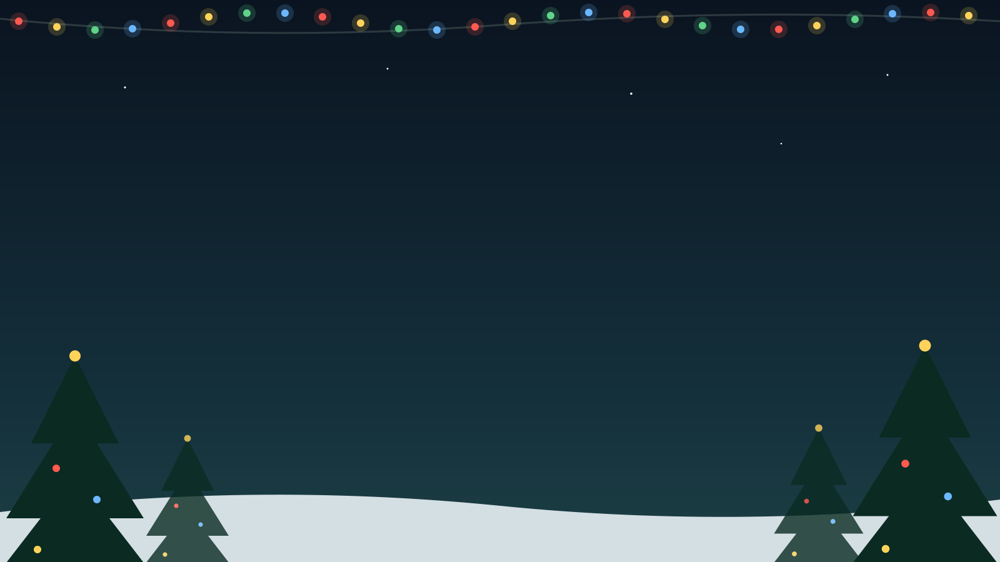
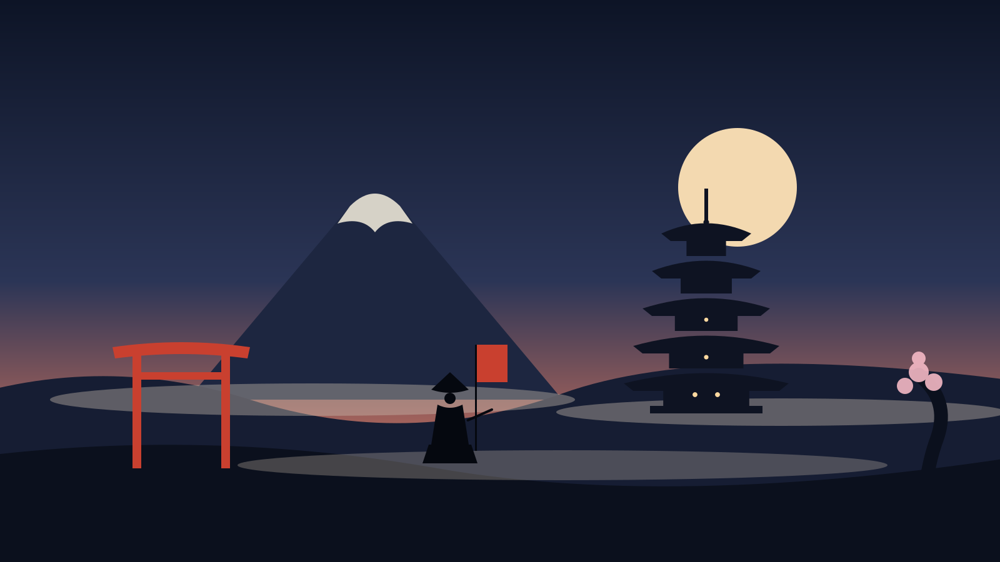

# Claude themes

Animated backdrops for the Claude desktop window. Each theme is its own plugin, and every theme listed here has a preview in `previews/`.

## desert-backdrop


A dusk desert: a low pulsing sun, drifting dunes, saguaros, twinkling stars and a warm dark palette.

## festive-backdrop



A winter night: falling snow, twinkling multicolor lights, snowy evergreens and a cool dark palette.

## moon-backdrop


A moonlit night: a softly glowing moon, drifting clouds, twinkling stars, an occasional shooting star and a deep blue palette.

## ancient-japan-backdrop



Ancient Japan at dawn in ink-wash layers: Mount Fuji, a tall five-tier pagoda, a samurai with a waving banner, a vermilion torii gate, and drifting mist, over an indigo palette with lacquer-red accents.

## solar-system-backdrop



A deep-space solar system: a pulsing sun, eight planets on slow elliptical orbits, moons, Saturn's rings, an asteroid belt, a comet and a faint Milky Way, over a dark palette.

## Install

Replace `<theme>` with `desert-backdrop`, `festive-backdrop`, `moon-backdrop`, `ancient-japan-backdrop` or `solar-system-backdrop`.

At the prompt of a terminal session:

```
/plugin install <theme> --marketplace m-vaysman/claude-themes
```

From a shell:

```
claude plugin install <theme> --marketplace m-vaysman/claude-themes
```

In the desktop app, where `/plugin` does not run: click + next to the prompt box, then Plugins, Add marketplace with `m-vaysman/claude-themes`, then Add plugin.

A session keeps one theme, so install one at a time.
